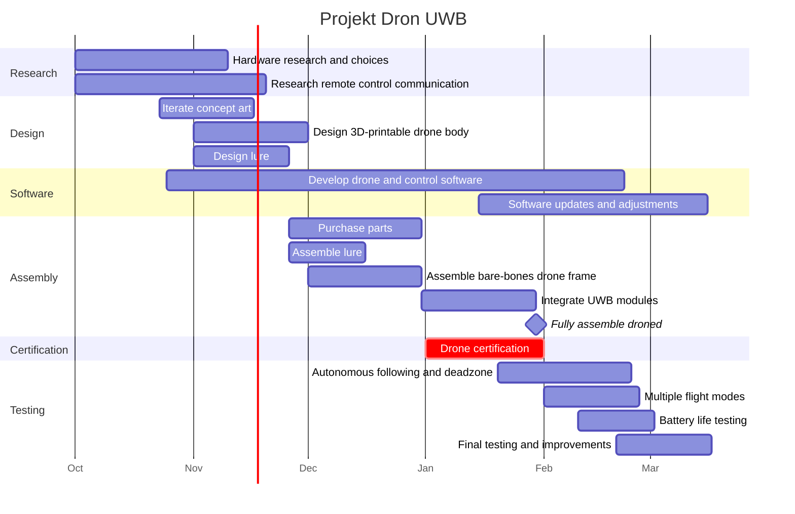

  

# Project breakdown
## What is it \[S\]
Drone following an object (the "lure").
Communicates with the "lure", a microcontroller carried by a person that sends a UWB signal, and identify the person holding the lure.
Using BU03 and BU04 modules alongside and ESP32c6 we can make the following system.
## Budget \[M\]
TBA
## Is it achievable \[A\]
Considering predispositions and the planning already started the project seems completable in the given timeframe.
## The purpose \[R\]
Example usages include:
- automatic recording hands-free, usable for motorcycle rides.
- looking cool following like a minion
## Time bounds \[T\]
Deadline in march, ~9 months.
## Goal
Achieve fully autonomous flight with a certain deadzone for safety.
## Sub-Goals
- Multiple flight modes.
- A battery life of at least 30 minutes.
## What is not included
- Handling multiple lures or drones
- Obstacle detection and avoidance
- Flight in harsh conditions
## Hardware list, prices and weight estimates
Updated often at [hardware list](docs/hardware.md)

## Risks
The differentiation here is:
| Category | Meaning |
| - | - |
| Risk | Might happen |
| Issue | Already true |
| Open decision | Not yet made |
| Expected cost/Problem | Will happen |

### Risks

<b>Risks</b>

| ID | Risk | Probability | Impact | Score | Priority |
| - | - | - | - | - | - |
| R1 | Shell may add weight because of 3d printing artifacts and drag and may disturb prop airflow | 0.2 | 0.4 | 0.08  | Low |
| R2 | Drone/component self injury while testing | 0.35 | 0.8 | 0.28 | Mid |
| R3 | Project deadline slips | 0.7 | 1 | 0.7 | High |
| R4 | Battery fire hazard | 0.2 | 1 | 0.2 | Critical |
| R5 | No legal certification in time for tests | 0.4 | 0.8 | | Mid-High |

<b>Risk response</b>

| ID | Preventative actions | Contingency plan |
| - | - | - |
| R1 | Take the slicers predicted mass and confirm with weigh in after print, then use that as $m_0$ | Fly without shell, reprint lighter |
| R2 | Don't go autonomous until manual is verified, do first flight in a secure area, config a kill switch, test motor outputs without props | Stop testing after anything uncontrollable happens |
| R3 | Minimum demo over everything, track progress weekly, order long-lead parts right now | 2 weeks wiggle on the deadline, project can keep on going after but we miss open days |
| R4 | Constant swelling inspection, keep a bag of sand on hand | Disconnect only if safe, call 112 or/and use a fire extinguisher |
| R5 | Find out the reqs right now | Theoretically the school is private property and with permission we can fly inside |
| N1 | Read the datasheets and attempt to disprove this theory | Lower the speed and tighten the deadzone, use Bluetooth/WiFi | 
| N2 | Check the datasheet latency and rate, tune the controller, smooth via lerp | Reduce max speed | 
| N3 | Get true nums from datasheet, measure it in real life | Lower mass/battery life expentancy and battery size |

<b>Open decisions</b>

| ID | Decision |
| - | - |
| O1 | What FC |
| O2 | FC firmware. |
| O3 | ESP32c6 and FC interface and protocol. |
| O4 | Frame, bought or printed. |
| O5 | Final flight time target |
| O6 | How do we height hold. |
| O7 | Budget figure. |

<b>Issues</b>

| ID | Issue |
| - | - |
| I1 | Knowledge gap on flight-controller, ESC and firmware topics. |

<b>Decisions</b>

| ID | Decision |
| - | - |
| D1 | Self-funded, no school budget |
| D2 | UWB for lure comms, BU04 on the drone for angle |
| D3 | Fixed height, 2D following only |
 

<b>Problems</b>

See more at [problems](docs/problems.md)
 
| ID | Problem |
| - | - |
| P1 | Long UWB delivery. Solution: Order ASAP |
 

<b>Not Enough Info</b>

| ID | Unknown |
| - | - |
| N1 | UWB AoA is not precise enough |
| N2 | Refresh rate does not allow stable and smooth following |
| N3 | Hover efficiency is unverified, so the 30 min goal could be missed |
 

<b>TODO</b>

Potencial gold mine of information - https://www.reddit.com/r/Multicopter/wiki/index/

- [ ] Research NEI section to organize it into risks, problems etc.
- [x] Find out the legal requirements to fly
  - Register at https://drony.gov.pl/
  - pass the exam for the A1/A3 subcategory (The drone is categorized as "drone constructed for private use")
  - ubezpieczenie OC
  - Sources: https://ulc.gov.pl/drony/informacje-ogolne, https://ulc.gov.pl/drony/kategoria-otwarta-informacje
- [ ] Find thrust and power tables for the shortlisted 2306 motor and 5" prop to replace $\eta$ guess 
- [ ] Confirm the ESC and flight controller support 6S
- [x] Check the BU04 and BU03 datasheets for AoA details
  | Parameter | BU03 | BU04 |
  | --- | --- | --- |
  | UWB chipset | Decawave DW3000 | Decawave DW3000 |
  | MCU | Not specified as integrated | STM32F103 integrated |
  | Antenna configuration | Single onboard ceramic antenna | Dual onboard PCB antennas |
  | External antenna | Not specified | Dual IPEX antenna support |
  | Antenna channels | Single antenna | Dual antenna channels |
  | PDOA support | Listed | Listed |
  | TDOA support | Listed | Listed |
  | Two-way ranging | Yes | Yes |
  | Positioning accuracy | Up to 10 cm (claimed) | Up to 10 cm (claimed) |
  | UWB channels | CH5 and CH9 | CH5 and CH9 |
  | CH5 frequency | 6489.5 MHz | 6489.5 MHz |
  | CH9 frequency | 7987.2 MHz | 7987.2 MHz |
  | Channel bandwidth | 499.2 MHz | 499.2 MHz |
  | Maximum data rate | 6.8 Mbps | 6.8 Mbps |
  | Interface | SPI | SPI, UART, I2C |
  | Available GPIO | 9 | 20 |
  | Supply voltage | 2.5–3.6 V | 2.5–3.6 V |
  | Recommended peak supply current | Above 200 mA | Above 500 mA |
  | Module dimensions | 23 × 13 × 2.5 mm | 35.5 × 33.5 × 3.4 mm |
  - Sources: 
    - BU03 - https://en.ai-thinker.com/Uploads/file/20240927/20240927135255_72398.pdf
    - BU04 - https://en.ai-thinker.com/Uploads/file/20240927/20240927190544_82504.pdf
- [ ] Order the UWB modules
- [ ] Check barometer vs alternatives for height hold (downward rangefinder, optical flow)
- [x] What are escs and a flight controller
  - ESC (Electronic Speed Controller) - "regulates the speed and rotation of a drone motor by managing the electrical current delivered to it. Acting as a communication bridge between the flight controller and the motor, the ESC interprets commands from the flight controller and adjusts motor speed accordingly."
  - Flight Controller - "A flight controller (sometimes called FC) is a small board you have in the middle of your multicopter. It has sensors (accelerometer and gyroscope, sometimes more) that let it know which way it's facing. The FC is connected between the receiver and the ESCs (electronic speed controllers). It keeps the board the way it's supposed to be. It can keep it level (autolevel) or the way you set it (without autolevel), so you won't have to keep balancing it yourself."
  - Sources:
    - ESC - https://www.tytorobotics.com/blogs/articles/what-is-an-esc-how-does-an-esc-work, https://www.grepow.com/blog/what-is-a-drone-esc-and-is-it-important.html
    - Flight Controller - https://www.reddit.com/r/Multicopter/comments/35zani/beginner_what_is_a_flight_controller_and_is_the/
- [ ] Learn how to pick the correct brushless motors
- [x] What is UART (Universal Asynchronous Receiver-Transmitter)
  - A hardware component that allows two electronic devices to communicate by sending and receiving data one bit at a time over serial connections.
  - Sources:
    - https://en.wikipedia.org/wiki/Universal_asynchronous_receiver-transmitter
    - https://www.circuitbread.com/tutorials/uart-universal-asynchronous-receiver-transmitter

## Battery model

Assumptions and formula

| Symbol | Meaning | Value | Confidence |
| - | - | - | - |
| $m_0$ | Drone mass - battery | 450 | 0.8 |
| $\eta$ | Hover efficiency | $7 \frac{g}{W}$ | 0.2 |
| $P_e$ | Electronic drain | 5 W | 0.5 |
| $u$ | Usable charge to keep reserver | 80% | 1 |
| $\rho$ | Charge per kg | LiPo $145 \frac{Wh}{kg}$, Li-on $230 \frac{Wh}{kg}$ | 0.5 |
| $t$ | flight time | 0.5 h | 0.9 |

$m_b=\frac{t(m_0+\eta P_e)}{\frac{u \rho \eta}{1000}-t}$

$E_{req} = \frac{\rho m_b}{1000}$
 

## Schedule
 

Gantt chart

PS: Lure development will already be in progress using WiFi to have a working demo. But the UWB version will be reinterpreted using our demo as noted on the Gantt diagram.

