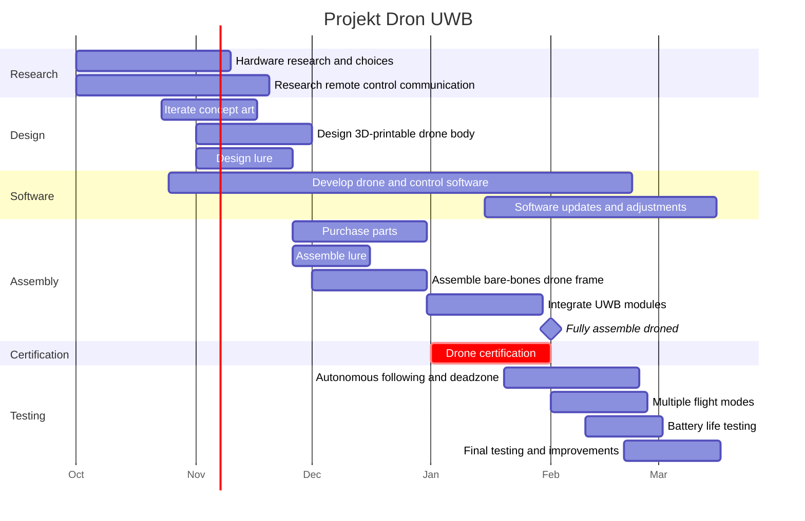

  

## Project breakdown

### What is it \[S\]
Drone following an object (the "lure").
Communicates with the "lure", a microcontroller carried by a person that sends a UWB signal, and identify the person holding the lure.
Using BU03 and BU04 modules alongside and ESP32c6 we can make the following system.
### Budget \[M\]
TBA
### Is it achievable \[A\]
Considering predispositions and the planning already started the project seems completable in the given timeframe.
### The purpose \[R\]
Example usages include:
- automatic recording hands-free, usable for motorcycle rides.
- looking cool following like a minion
### Time bounds \[T\]
Deadline in march, ~9 months.
### Goal
Achieve fully autonomous flight with a certain deadzone for safety.
#### Sub-Goals
- Multiple flight modes.
- A battery life of at least 30 minutes.
### What is not included
- Handling multiple lures or drones
- Obstacle detection and avoidance
- Legal certification
- Flight in harsh conditions
### Unorganized milestones
- Finish hardware research and choices
- Obtaining drone certification
- Start demoing a lure - drone ping app via WiFi because of the lack of an UWB module on hand
- Iterate concept art
- Research how remote control communication works
- Design a bare bones remote control system
- Design a 3d printable body for the drone
- Start assembly on a bare bones frame
### Problems
See more at [problem](docs/problems.md)
### Unorganized risks
- Delivery of the UWB module taking a long time
- Drone harming used components via crashing

