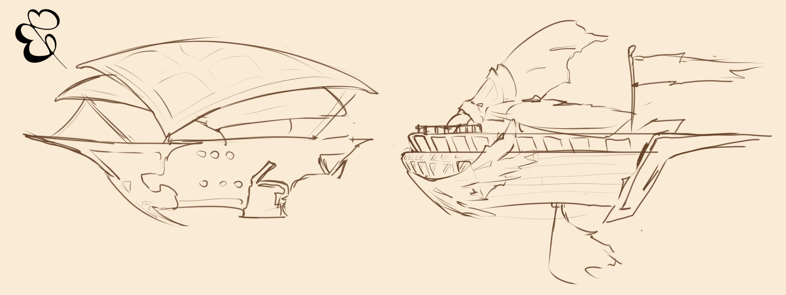
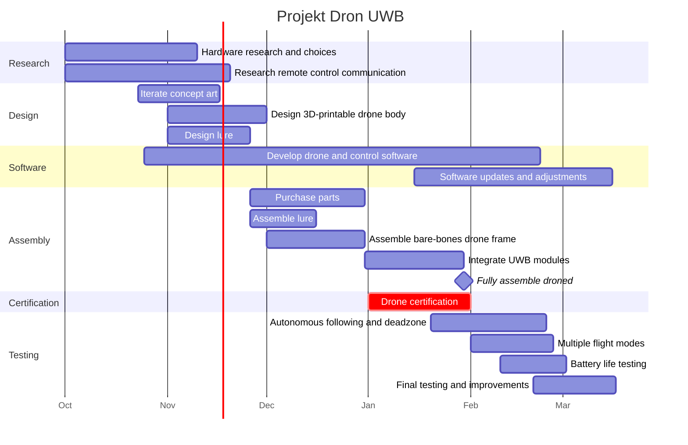

  

# Project breakdown
## What is it \[S\]
Drone following an object (the "lure").
Communicates with the "lure", a microcontroller carried by a person that sends a UWB signal, and identify the person holding the lure.
Using BU03 and BU04 modules alongside and ESP32c6 we can make the following system.
## Budget \[M\]
TBA
## Is it achievable \[A\]
Considering predispositions and the planning already started the project seems completable in the given timeframe.
## The purpose \[R\]
Example usages include:
- automatic recording hands-free, usable for motorcycle rides.
- looking cool following like a minion
## Time bounds \[T\]
Deadline in march, ~9 months.
## Goal
Achieve fully autonomous flight with a certain deadzone for safety.
## Sub-Goals
- Multiple flight modes.
- A battery life of at least 30 minutes.
## What is not included
- Handling multiple lures or drones
- Obstacle detection and avoidance
- Flight in harsh conditions
## Hardware list, prices and weight estimates
Updated often at [hardware list](docs/hardware.md)

## Risks
The differentiation here is:
| Category | Meaning |
| - | - |
| Risk | Might happen |
| Issue | Already true |
| Open decision | Not yet made |
| Expected cost/Problem | Will happen |

### Risks
 
| ID | Risk | Probability | Impact | Score | Priority |
| - | - | - | - | - | - |
| R1 | Shell may add weight because of 3d printing artifacts and drag and may disturb prop airflow | | | | |
| R2 | Drone/component self injury while testing | | | | |
| R3 | Project deadline slips | | | | |
| R4 | Battery fire hazard | | | | |
| R5 | No legal certification in time for tests | | | | |

<b>Open decisions</b>

| ID | Decision |
| - | - |
| O1 | What FC |
| O2 | FC firmware. |
| O3 | ESP32c6 and FC interface and protocol. |
| O4 | Frame, bought or printed. |
| O5 | Final flight time target |
| O6 | How do we height hold. |
| O7 | Budget figure. |

<b>Issues</b>

| ID | Issue |
| - | - |
| I1 | Knowledge gap on flight-controller, ESC and firmware topics. |

<b>Decisions</b>

| ID | Decision |
| - | - |
| D1 | Self-funded, no school budget |
| D2 | UWB for lure comms, BU04 on the drone for angle |
| D3 | Fixed height, 2D following only |
 

<b>Problems</b>

See more at [problems](docs/problems.md)
 
| ID | Problem |
| - | - |
| P1 | Long UWB delivery. Solution: Order ASAP |
 

<b>Not Enough Info</b>

| ID | Unknown |
| - | - |
| N1 | UWB AoA is not precise enough |
| N2 | Refresh rate does not allow stable and smooth following |
| N3 | Hover efficiency is unverified, so the 30 min goal could be missed |
 

## TODO

<b>TODO</b>

- [ ] Research NEI section to organize it into risks, problems etc.
- [ ] Find out the legal requirements to fly
- [ ] Find thrust and power tables for the shortlisted 2306 motor and 5" prop to replace $\eta$ guess 
- [ ] Confirm the ESC and flight controller support 6S
- [ ] Check the BU04 and BU03 datasheets for AoA details
- [ ] Order the UWB modules
- [ ] Check barometer vs alternatives for height hold (downward rangefinder, optical flow)
- [ ] What the fuck are escs and a flight controller
- [ ] Learn how to pick the correct brushless motors
- [ ] What is UART

## Battery model

Assumptions and formula

| Symbol | Meaning | Value | Confidence |
| - | - | - | - |
| $m_0$ | Drone mass - battery | 450 | 0.8 |
| $\eta$ | Hover efficiency | $7 \frac{g}{W}$ | 0.2 |
| $P_e$ | Electronic drain | 5 W | 0.5 |
| $u$ | Usable charge to keep reserver | 80% | 1 |
| $\rho$ | Charge per kg | LiPo $145 \frac{Wh}{kg}$, Li-on $230 \frac{Wh}{kg}$ | 0.5 |
| $t$ | flight time | 0.5 h | 0.9 |

$m_b=\frac{t(m_0+\eta P_e)}{\frac{u \rho \eta}{1000}-t}$
$E_{req} = \frac{\rho m_b}{1000}$
 

## Schedule
 

Gantt chart

PS: Lure development will already be in progress using WiFi to have a working demo. But the UWB version will be reinterpreted using our demo as noted on the Gantt diagram.

